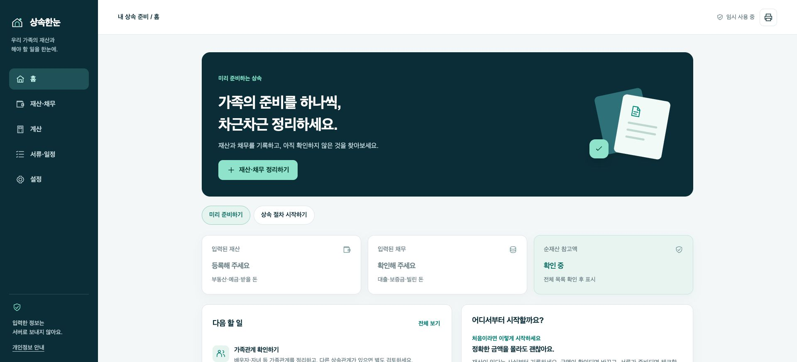

# 상속한눈 · Web

가족의 재산·채무와 상속 준비를 정리하는 모바일 우선 웹앱입니다.

- 웹: https://softm.github.io/sangsokhannun/
- Android: https://github.com/softm/sangsokhannun-android
- 자료 확인 상태: https://softm.github.io/sangsokhannun/data-status.html
- 개인정보 안내: https://softm.github.io/sangsokhannun/privacy.html



## 초기 기능

| 기능 | 범위 |
|---|---|
| 준비·진행 모드 | 미리 준비하기, 상속 절차 진행하기 |
| 재산·채무 | 항목 추가·수정·삭제, 지분, 금액 미확인과 0원 구분 |
| 기본 계산 | 자녀가 있는 일반 공동상속의 법정상속분과 제한된 기본 공제 기준 참고 상속세 |
| 할 일·일정 | 공식 링크, 완료 상태, 서로 다른 기산점의 참고 날짜 |
| 자료 보관 | 최초 메모리 모드, 선택적 비밀번호 기반 기기 암호화 저장 |
| 내보내기 | 암호화 백업·복원, 상담 자료 인쇄/PDF |

## 실행·검증

Node.js 22 이상과 Python 3을 사용합니다. npm 패키지 설치 없이 실행합니다.

```sh
npm test
npm run check
npm run build
npm start
```

http://127.0.0.1:8080 에서 확인합니다. WebCrypto를 위해 운영 환경은 HTTPS가 필요합니다.

## 배포

GitHub Settings → Pages → Source를 GitHub Actions로 설정합니다. main에 push하면 테스트·문법·로컬 자산 검사 후 dist만 배포합니다. PR에서는 검증만 수행합니다. 업로드 artifact 보관은 1일입니다.

앱 및 안내 소스만 공개합니다. 사용자가 입력한 재산·가족관계·백업은 저장소에 포함하지 않습니다.

## 계산의 적용 범위

2026-11-19에 확인한 국세청·정부24·생활법령정보·국가법령정보센터의 안내를 기준으로 구현했습니다. 상세 출처는 data/sources.json에 있습니다.

- 기본 세금 계산은 국내 거주자, 자녀가 있는 일반 사례, 사전증여·유언·상속포기·특수재산·해외 관계가 없고 모든 재산·공제 가능한 채무를 확인한 경우에 한정합니다.
- 일괄공제 5억 원과 배우자가 있는 경우 기본 배우자공제 5억 원을 순재산 범위 내에서 적용합니다. 더 유리한 인적공제 조합, 추가 배우자공제, 금융재산·동거주택·영농·가업 공제, 장례비용, 신고세액공제 등은 반영하지 않습니다.
- 전체 재산 기준 참고 산출세액이며 개인별 세액, 확정 신고세액, 최적 절세안이 아닙니다.
- 미확인·미검증 항목, 전체 목록 미확인, 지원하지 않는 사례는 숫자를 확정하지 않습니다.
- 기한은 월 단위 기준의 참고 날짜입니다. 휴일, 법원 연장, 특별한정승인 등은 반영하지 않으므로 관할 기관에서 최종 기한을 확인해야 합니다.
- 공식 재산조회 자동연동, 서류 자동발급·제출, 가족 실시간 공유, OCR은 초기 버전에 포함하지 않습니다.

## 저장·보안

최초에는 메모리에만 보관하며 새로고침·닫기 시 자료가 사라질 수 있습니다. 사용자가 기기 저장을 선택하면 WebCrypto로 암호화합니다. 비밀번호를 잃으면 복구할 수 없으므로 암호화 백업을 별도로 보관해야 합니다. 외부 분석 도구·광고 스크립트를 웹에 넣지 않습니다. 호스팅 제공자의 일반 접속 기록까지 없다는 의미는 아닙니다.

## Android 연결

Android는 이 웹을 표시하고 독립 한눈 공통 AdMob/인앱 업데이트 라이브러리를 사용합니다. 별도 JavaScript 인터페이스로 가족·재산을 조회하지 않습니다. 암호화 백업 저장, 인쇄, 광고 노출을 방해하면 안 되는 입력 상태만 최소 메시지로 처리합니다.

새 기능은 AGENTS.md의 공통 원칙을 따릅니다.
